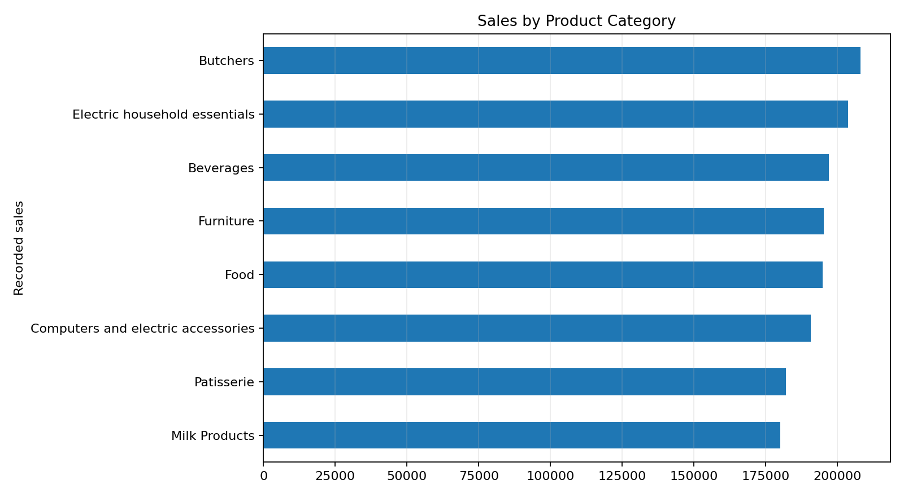
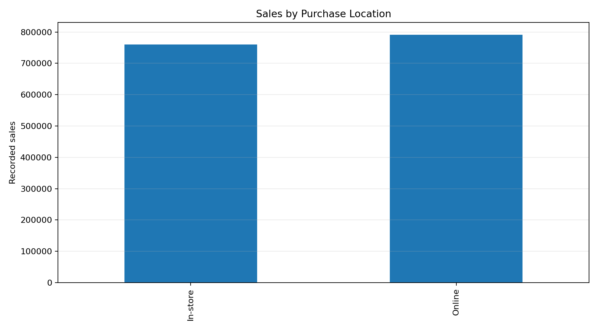
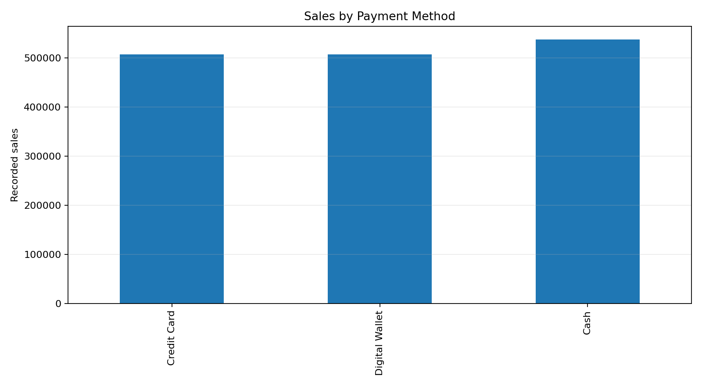
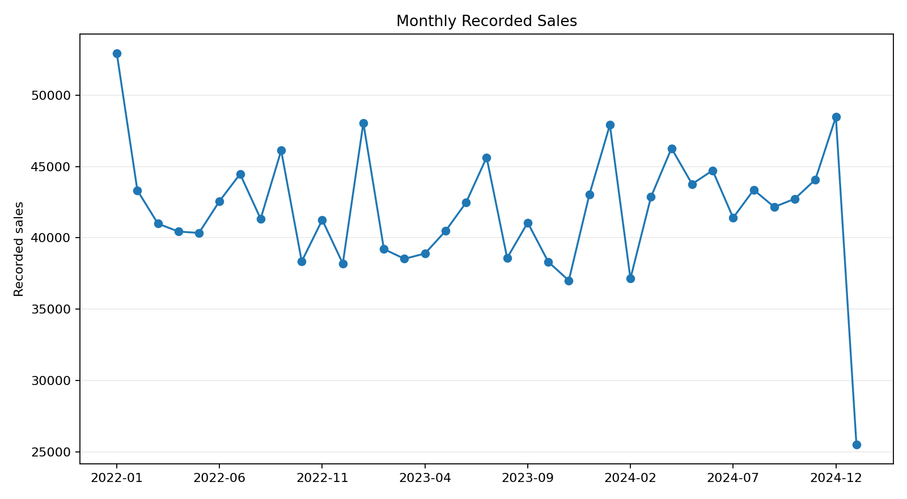

# Retail Sales Performance Analysis and Interactive Business Intelligence Dashboard

**SWYNEX Final Data Analytics Project**  
**Student:** Lohit V.  
**Registration Number:** U19MT24S0127  
**Project Type:** Data Analytics and Business Intelligence  

---

## 1. Problem Statement

Retail businesses generate transaction records across product categories, payment methods and sales channels. Without summarising these records, it can be difficult to identify which categories and channels contribute the most recorded sales, understand payment-method patterns, or observe changes across the available dates.

The objective of this project is to analyse a retail store sales dataset, prepare it for analysis, calculate descriptive sales measures, identify useful business patterns, and present the results in an interactive dashboard. The project is descriptive: it reports patterns in the supplied data and does not claim to establish why those patterns occurred.

## 2. Dataset Information

- **Dataset:** Retail Store Sales — Raw Dataset
- **File:** `retail_store_sales_raw.csv`
- **Original source:** [Maichel25 / retail-sales-data-cleaning](https://github.com/Maichel25/retail-sales-data-cleaning/blob/main/retail_store_sales.csv)
- **Rows and columns:** 12,575 rows × 11 columns
- **Date coverage:** 1 January 2022 to 18 January 2025
- **Fields:** Transaction ID, Customer ID, Category, Item, Price Per Unit, Quantity, Total Spent, Payment Method, Location, Transaction Date and Discount Applied.

The dataset contains transaction-level retail records. The analysis uses the cleaned CSV produced during the earlier data-cleaning task. The raw source CSV is also included in the `data` folder to make the project inputs transparent.

## 3. Cleaning Process

The cleaning process was completed as part of the earlier SWYNEX data-cleaning task. The cleaned file is reused here so that the final analysis and dashboard are based on the same prepared data.

| Data quality issue in raw data | Treatment documented in the cleaning task |
|---|---|
| 1,213 missing `Item` values | Replaced with `Unknown`; no item identity was invented |
| 4,199 missing `Discount Applied` values | Replaced with `Unknown`; not assumed to be True or False |
| 609 missing `Price Per Unit` values | Inferred where possible using the transaction relationship and available values |
| 604 rows missing both `Quantity` and `Total Spent` | Retained, because the missing transaction amounts could not be reliably reconstructed |
| Duplicate transaction IDs | No duplicate IDs were found in the cleaned dataset |

The cleaned dataset contains 12,575 rows and 11 columns. `Quantity` and `Total Spent` remain missing together for 604 records. These records are retained for transparency but excluded from sales totals and average transaction value calculations. Missing values in `Item` and `Discount Applied` are represented by `Unknown`.

## 4. Analysis Performed

The analysis was carried out using Python and Pandas. The main measures are:

- Total recorded sales, calculated from rows with a non-missing `Total Spent` value.
- Number of transactions with a recorded sales amount.
- Average and median transaction value.
- Unique customer count.
- Recorded sales grouped by product category, purchase location, payment method and month/year.
- A simple IQR-based check to flag unusually high transaction values for review. Potential outliers were not automatically deleted.

### 4.1 Overall results

| Measure | Result |
|---|---:|
| Dataset records | 12,575 |
| Transactions with recorded sales | 11,971 |
| Rows excluded from sales calculations due to missing `Total Spent` | 604 |
| Total recorded sales | 1,552,071.00 |
| Average transaction value | 129.65 |
| Median transaction value | 108.50 |
| Unique customers | 25 |
| Duplicate transaction IDs | 0 |
| Potential high-value outliers flagged by IQR rule | 60 |

### 4.2 Sales by category

| Category | Recorded sales |
|---|---:|
| Butchers | 208,118.00 |
| Electric household essentials | 203,813.50 |
| Beverages | 197,047.50 |
| Furniture | 195,310.00 |
| Food | 194,812.00 |
| Computers and electric accessories | 190,692.50 |
| Patisserie | 182,165.50 |
| Milk Products | 180,112.00 |



### 4.3 Sales by purchase location

| Location | Recorded sales |
|---|---:|
| Online | 791,401.00 |
| In-store | 760,670.00 |



### 4.4 Sales by payment method

| Payment method | Recorded sales |
|---|---:|
| Cash | 537,710.00 |
| Digital Wallet | 507,279.00 |
| Credit Card | 507,082.00 |



### 4.5 Year-wise recorded sales

| Year | Recorded sales |
|---|---:|
| 2022 | 510,329.50 |
| 2023 | 491,312.00 |
| 2024 | 524,881.00 |
| 2025 (partial, through 18 January) | 25,548.50 |



The 2025 data covers only the first 18 days of January. It is therefore a partial period and should not be compared directly with complete calendar years.

## 5. Interactive Dashboard

The project includes a Streamlit dashboard (`app.py`) with the following features:

- Interactive filters for product category, purchase location, payment method and year.
- KPI cards for recorded sales, transactions with recorded sales, average transaction value and unique customers.
- Charts for sales by category, purchase location, payment method and monthly trend.
- Five dynamic insights that update with the selected filters: leading category, leading location, leading payment method, highest-sales year in the selection, and average transaction value.
- A filtered transaction sample and a data-quality notes section.

To run the dashboard locally, install the packages in `requirements.txt` and run:

```bash
streamlit run app.py
```

## 6. Key Business Insights

1. **Butchers recorded the highest category sales.** Its recorded sales were 208,118.00, followed by Electric household essentials at 203,813.50. This identifies the leading categories by sales value in this dataset; it does not explain the reasons for their performance.
2. **Online sales were higher than in-store sales.** Online recorded 791,401.00 compared with 760,670.00 in-store. The difference is 30,731.00 in the analysed records.
3. **Cash was the largest payment method by recorded sales.** Cash accounted for 537,710.00, with Digital Wallet and Credit Card close behind.
4. **2024 had the highest full-year recorded sales among the complete years shown.** It recorded 524,881.00, compared with 510,329.50 in 2022 and 491,312.00 in 2023.
5. **Data completeness affects the totals.** 604 records have no recorded `Total Spent`; excluding them from the sales calculations avoids treating unknown values as zero or fabricating amounts.
6. **Outliers require review, not automatic deletion.** The IQR check flagged 60 potentially high-value transactions. These may be valid purchases and should be checked against source records before any removal.

## Conclusion

This project demonstrates an end-to-end descriptive retail analytics workflow: using a documented cleaned dataset, calculating sales measures, comparing categories and channels, examining time-based patterns, and communicating results through an interactive dashboard. The analysis provides a clear summary of the supplied records while documenting data limitations that affect interpretation.

## Limitations

- The dataset does not include cost, expense, margin or inventory information. Profit and profitability cannot be calculated.
- The 604 rows with missing `Quantity` and `Total Spent` cannot contribute to sales totals or average transaction value.
- The dataset contains only 25 unique customer IDs; customer-level conclusions should be treated cautiously.
- The 2025 period is incomplete and ends on 18 January 2025.
- The analysis is descriptive and does not establish causation or predict future sales.

## Reproducibility

Run `python analysis.py` from the project folder to regenerate the summary metrics and chart images in `outputs/`. Run `streamlit run app.py` to launch the interactive dashboard.
